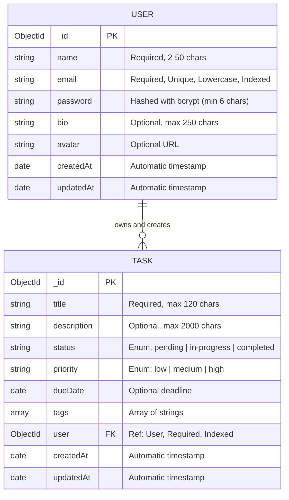

# TaskFlow — Database Schema & Architecture

This document describes the MongoDB database design, schema definitions, indexing strategies, entity relationships, and aggregation pipelines utilized in the **TaskFlow** system.

---

## 1. Entity Relationship Diagram (ERD)



---

## 2. Collections & Schema Details

### 2.1 `users` Collection

Stores registered user credentials, profile information, and account metadata.

| Field Name | Type | Constraints & Defaults | Description |
| :--- | :--- | :--- | :--- |
| `_id` | `ObjectId` | Auto-generated Primary Key | Unique user identifier |
| `name` | `String` | Required, trimmed, min: 2, max: 50 | User's full display name |
| `email` | `String` | Required, unique, trimmed, lowercase, regex validated | Account login address |
| `password` | `String` | Required, min: 6, hashed with bcrypt, `select: false` | Encrypted password hash |
| `bio` | `String` | Optional, max: 250, default: `""` | User status or bio |
| `avatar` | `String` | Optional, default: `""` | Profile picture URL |
| `createdAt` | `Date` | Mongoose auto-timestamp | Account registration timestamp |
| `updatedAt` | `Date` | Mongoose auto-timestamp | Last profile update timestamp |

#### Password Security & Pre-Save Hook
- Passwords are salt-hashed using `bcryptjs` with 10 salt rounds before being persisted.
- Passwords have `select: false` configured so queries by default never leak hashed passwords in JSON responses.
- The `matchPassword` method safely verifies plaintext credentials during login using `bcrypt.compare`.

---

### 2.2 `tasks` Collection

Stores user-created tasks, statuses, priorities, deadlines, and associations.

| Field Name | Type | Constraints & Defaults | Description |
| :--- | :--- | :--- | :--- |
| `_id` | `ObjectId` | Auto-generated Primary Key | Unique task identifier |
| `title` | `String` | Required, trimmed, max: 120 | Concise title of the task |
| `description`| `String` | Optional, trimmed, max: 2000, default: `""` | Detailed task instructions |
| `status` | `String` | Enum: `['pending', 'in-progress', 'completed']`, default: `'pending'` | Current task progress state |
| `priority` | `String` | Enum: `['low', 'medium', 'high']`, default: `'medium'` | Importance / urgency level |
| `dueDate` | `Date` | Optional, default: `null` | Target deadline |
| `tags` | `[String]` | Array of strings, default: `[]` | Categorization tags |
| `user` | `ObjectId` | Required, Reference to `User` model, Indexed | User who owns the task |
| `createdAt` | `Date` | Mongoose auto-timestamp | Creation timestamp |
| `updatedAt` | `Date` | Mongoose auto-timestamp | Last modification timestamp |

---

## 3. Database Indexing Strategy

To guarantee rapid query response times under high concurrency, compound and single-field indexes are enforced:

```javascript
// Compound indexes for user-scoped filtered queries
taskSchema.index({ user: 1, status: 1 });
taskSchema.index({ user: 1, priority: 1 });
taskSchema.index({ user: 1, dueDate: 1 });
taskSchema.index({ user: 1, createdAt: -1 });

// User collection index
userSchema.index({ email: 1 }, { unique: true });
```

### Why Compound Indexing?
Every query in TaskFlow strictly scopes by the authenticated user's ID (`{ user: req.user._id, status: ... }`). By prefixing compound indexes with `user: 1`:
1. Queries avoid full collection scans (`COLLSCAN`), instead using efficient index scans (`IXSCAN`).
2. Sorting tasks by creation date (`{ user: 1, createdAt: -1 }`) performs an in-index sort without loading documents into memory.

---

## 4. Aggregation Pipeline (`/api/tasks/stats`)

Instead of making multiple heavy queries or processing arrays in application memory, TaskFlow leverages MongoDB's native aggregation framework:

```javascript
// Group counts by status
Task.aggregate([
  { $match: { user: userId } },
  { $group: { _id: '$status', count: { $sum: 1 } } }
]);

// Group counts by priority
Task.aggregate([
  { $match: { user: userId } },
  { $group: { _id: '$priority', count: { $sum: 1 } } }
]);

// Count overdue tasks
Task.countDocuments({
  user: userId,
  status: { $ne: 'completed' },
  dueDate: { $ne: null, $lt: new Date() }
});
```

This aggregation executes directly in the database engine, returning instant statistical summaries used by the frontend dashboard.
